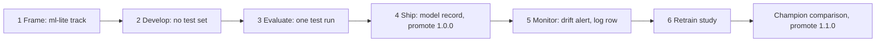

# Guided demo: build, ship, monitor and retrain a model

This demo shows the full model lifecycle of the template in about 10 minutes. It uses data from scikit-learn, a local MLflow store and no cloud account. It needs no external data.

## Run the demo

1. Run `uv sync` once.
2. Run `uv run poe demo`. The demo pauses before each act and before each human approval.
3. To run without pauses, run `uv run poe demo --yes`.

Options:

|Option|Effect|
|---|---|
|`--yes`|Run without pauses.|
|`--workspace PATH`|Use another sandbox folder. The default is `.demo/`.|
|`--approver NAME`|Name for the human approvals. The default is `Demo Lead`.|
|`--owner NAME`|Owner of the studies and of the model record.|

The demo deletes and rebuilds the sandbox at each start. Git ignores `.demo/`. The demo does not change `studies/`, `data/`, `models/` or `model-records/` of the repository.

## The story

A diagnostics team wants to read likely malignant cases first. The data science team builds a classifier that orders the reading queue. The model is low risk because a human reads every case. Later, the laboratory installs a new scanner. The scanner reads size features 25% larger. The ranking stays good, but the probabilities become wrong. The weekly monitor finds the shift. The team retrains, compares the challenger with the champion, and promotes the new version.

## Acts and talking points

|Act|What the audience sees|Point to make|
|---|---|---|
|1 Frame|`dsflow new` refuses the `ml-lite` track for a high risk tier. The empty charter fails `dsflow check` with `[[FILL` errors. The agent draft passes. A human approves.|The risk tier selects the path. A low-risk model has 5 gates, not 9.|
|2 Develop|`dsproject train` runs without the test set. The agent writes a wrong number. Gate rule 9 rejects it. The corrected claim passes.|Every number in an artifact is a claim that the gate checks against the run files. Agents cannot invent results.|
|3 Evaluate|One `--score-test` run. The evaluation report and the model card cite it. The gate checks the data checksum against `data/manifest.json`.|The test set is opt-in and used once. The report links to the exact data.|
|4 Ship|`dsflow model new` creates `model-records/tumour-classifier.toml`. A human runs `dsflow model promote`. `dsflow status` shows the model.|The champion lives in a reviewed file in git. Only a human promotes.|
|5 Monitor|`dsproject monitor` checks the new scanner batch. It exits 1 with an alert and adds a risk row to the study log.|A scheduler runs this command. A finding cannot get lost, because it lands in the study log.|
|6 Retrain|A `retrain` study with four short phases. `dsproject compare` scores champion and challenger on the same new data. A human promotes version 1.1.0 and sets the new monitoring reference.|Maintenance is a normal, short, gated path, not a new project. `dsflow model rollback` restores 1.0.0 and its reference in one command.|

## Where the agent fits

In real work an agent drafts each artifact with the phase skill in `.agents/skills/`. The files in `.dsflow/demo/artifacts/` stand in for those drafts, so the demo is fast and gives the same result each time. The placeholders in the files, for example `<<claim:v1-final:test.log_loss>>`, become evidence claims with the real values from the runs.

To show a live agent, run the demo to the end of act 1. Then ask an agent to draft `04-experiment-log.md` with the `dsflow-develop` skill. Then run `uv run dsflow check 001 develop` in the sandbox. Set `DSFLOW_ROOT`, `DSPROJECT_ROOT` and `MLFLOW_TRACKING_URI` to the sandbox before you run commands there.

## Files to open after the demo

|Path in `.demo/`|Content|
|---|---|
|`studies/001-tumour-classifier/`|The first study: charter, experiment log, evaluation report, model card, deployment spec, retrospective, log.|
|`studies/002-tumour-refresh/`|The retrain study: retrain brief, experiment log, evaluation report, champion comparison, deployment spec.|
|`model-records/tumour-classifier.toml`|The champion and the promotion history.|
|`reports/monitoring/tumour-classifier/`|The monitoring report.|
|`reports/002-tumour-refresh/champion-comparison.json`|The comparison result.|

To open the MLflow UI on the sandbox store, use the command that the demo prints at the end.
