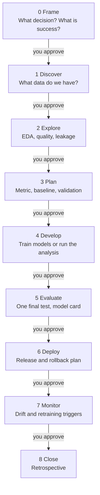

# ds-mlops

A template repository for data science, analytics and MLOps. You work with an AI agent. The agent follows a fixed process from problem framing to close. You make the decisions and approve each step.

## Why

Data science work fails in predictable ways. The objective is unclear. The data has leakage. Teams use the test set too early. Nobody records why the team chose a model. The template makes each of these failure points a written, reviewable step.

- Decisions have a written record and an owner.
- Claims cite evidence.
- Gates stop work that skips a step.
- The CLI checks the rules that a computer can check.

## How you work

Each piece of work is a study. A study moves through phases. In each phase, the agent writes one or more artifacts. An artifact is a Markdown document, for example the charter or the model card.

You do not need to learn the commands. You ask the agent for the work in plain language. The agent loads the matching skill. A skill is a written procedure for one phase. The skill tells the agent which commands to run and which checks to pass.

At the end of each phase, the agent asks you to review the artifacts. If you agree, you approve the phase. Then the next phase can start. Only a human can approve.

## Get started

1. Create a repository from this template on GitHub.
2. Run the bootstrap script. It installs the environment.
   - Windows (PowerShell): `powershell -ExecutionPolicy Bypass -File scripts/bootstrap.ps1`
   - macOS and Linux: `./scripts/bootstrap.sh`
3. Optional: run `uv run poe demo`. It runs a complete example study in about 10 minutes. See [.dsflow/demo/README.md](.dsflow/demo/README.md).
4. Open the repository in your agent, for example Claude Code.
5. Ask the agent: "Start a new study about customer churn."

The agent then asks you questions about the problem and writes the charter.

## The phases

The table shows what to ask the agent in each phase. You can also name the skill in your request.

| Phase | The agent writes | Ask the agent, for example | Skill |
|---|---|---|---|
| 0 Frame | The charter | "Start a new study about churn." | `dsflow-frame` |
| 1 Discover | The data card | "Write the data card." | `dsflow-discover` |
| 2 Explore | The EDA report and notebook | "Do the EDA." | `dsflow-explore` |
| 3 Plan | The experiment plan or analysis plan | "Plan the experiments." | `dsflow-plan` |
| 4 Develop | The experiment log or analysis log | "Run the experiments." | `dsflow-develop` |
| 5 Evaluate | The evaluation report and model card, or the findings report | "Evaluate the model." | `dsflow-evaluate` |
| 6 Deploy | The deployment spec | "Write the deployment spec." | `dsflow-deploy` |
| 7 Monitor | The monitoring plan | "Write the monitoring plan." | `dsflow-monitor` |
| 8 Close | The retrospective | "Close the study." | `dsflow-retro` |

Other skills help at any phase:

| Ask the agent, for example | Skill |
|---|---|
| "Is this phase ready for approval?" | `dsflow-gate` |
| "Record this decision." | `dsflow-decide` |
| "Let the agent try ideas overnight." | `dsflow-autoresearch` |
| "Fix the style warnings in this file." | `dsflow-write` |

A later finding can send the study back to an earlier phase. The agent tells you when this occurs.

### Not every study uses every phase

Each study has a track and a risk tier. The agent helps you choose them in phase 0.

| Track | Use it when | Phases |
|---|---|---|
| `ml` | You build a model for production. | All 9 phases |
| `ml-lite` | You build a simple model with a low risk tier. | 0, 4, 5, 6, 8 |
| `analysis` | You answer a question and build no model for production. | 0 to 5, then 8 |
| `retrain` | You replace a deployed model with a new version. | 0, 4, 5, 6 |

## Your part as the human

The agent runs most commands for you. You run the commands that record a human decision. Agents never run these commands.

| When | Run |
|---|---|
| You want to see where each study is. | `uv run dsflow status` |
| You approve a phase. | `uv run dsflow approve <study> <phase> --by "Your Name"` |
| You put a model version into production. | The command that the agent gives you in the deploy approval request. It starts with `uv run dsflow model promote`. |
| You go back to the earlier model version. | `uv run dsflow model rollback <model> --by "Your Name"` |

The agent stops and asks you when it needs a decision. Examples are an unclear metric or contact with the test set. See [docs/process/collaboration.md](docs/process/collaboration.md).

## Where your work goes

| Folder | Content |
|---|---|
| `studies/<study-id>/` | The artifacts of a study and the study log. |
| `notebooks/<study-id>/` | The notebooks of a study. |
| `reports/<study-id>/` | Figures and reports. |
| `configs/` | Training configs. |
| `src/dsproject/` | The reusable ML code. |
| `model-records/` | One file per deployed model. It names the current production version (the champion) and its history. |
| `models/` | Trained model files. Git ignores this folder. |

The framework files are in `.dsflow/`. They are the process CLI, the templates, the demo and their tests. You do not need to open them.

## AWS SageMaker

Work is local-first. The same training code runs on a laptop and on AWS SageMaker. See [docs/standards/aws-sagemaker.md](docs/standards/aws-sagemaker.md).

## More information

- [The lifecycle in detail](docs/process/lifecycle.md)
- [How humans and agents work together](docs/process/collaboration.md)
- [Supervised autoresearch](docs/process/autoresearch.md)
- [Glossary](docs/glossary.md)
- [Standards](docs/standards/): writing, technology, Python, data, modeling, responsible AI, operations, AWS SageMaker
- [AGENTS.md](AGENTS.md): the full command reference and repository map, for agents and maintainers
